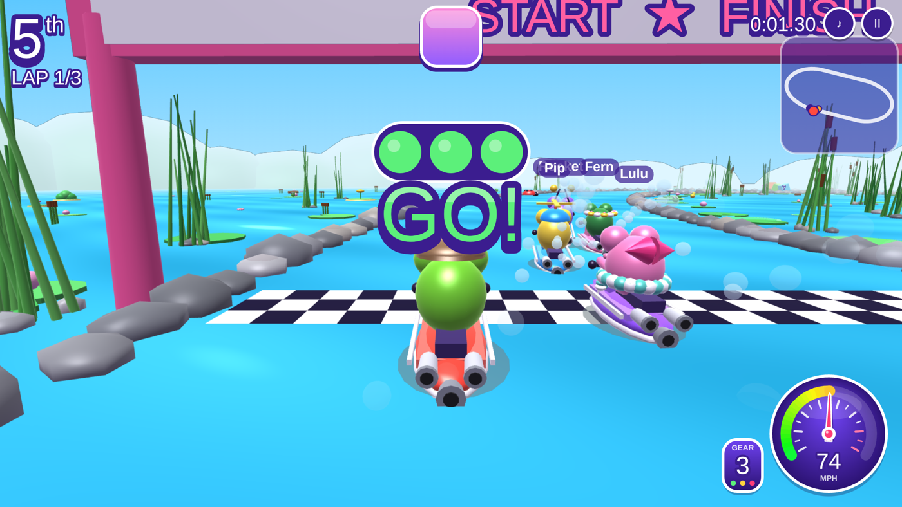
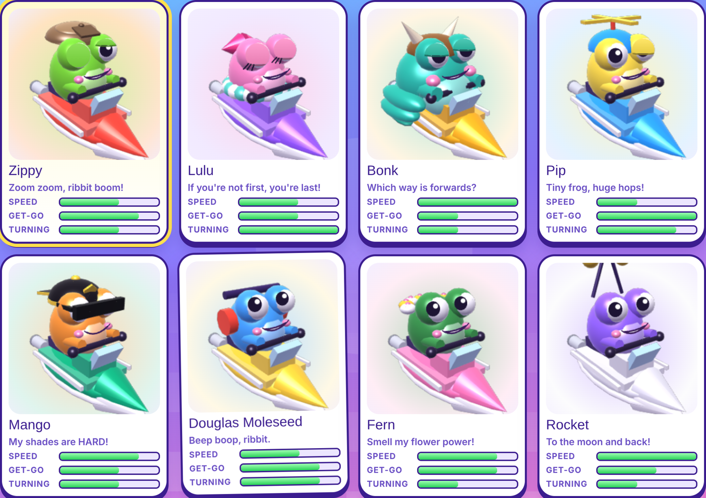
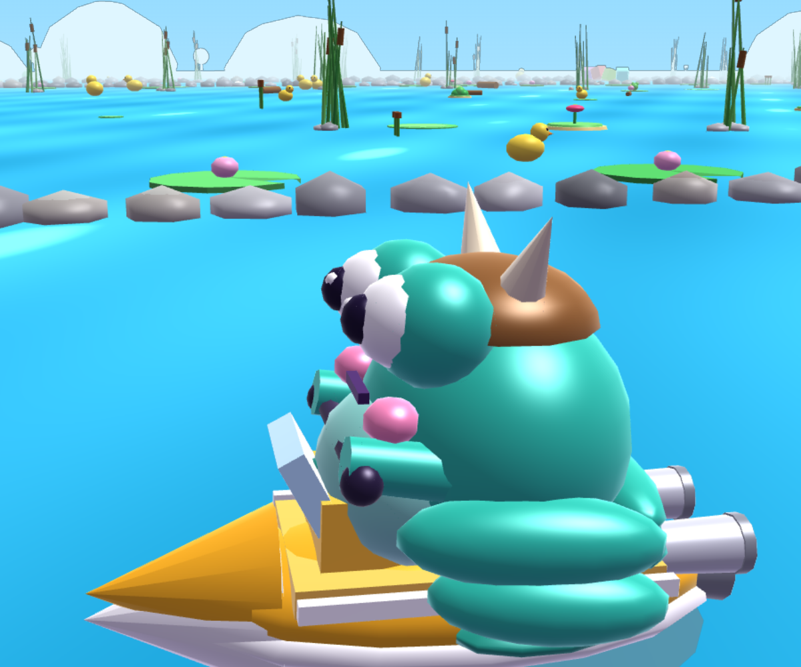
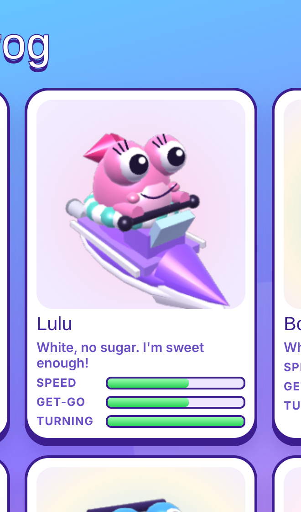

# 🐸 Ribbit Rally

A bright, bouncy kids' racing game: eight frogs on jetskis race around **81 pond courses** across 4 levels, grabbing **? boxes** for items like the Bubble Blaster, Buzzy Fly and Sticky Tongue, while dodging sprinklers, buzzing insects, bird poo and giant koi carp that gulp racers and spit them into the air.



## Play it

- **Download the app** for Windows, Mac or Linux from the [**Releases** page](../../releases/latest). The release notes say which file is right for your computer.
- **Play in a browser** (great for iPhone, iPad, Android and Chromebook) on this repository's GitHub Pages site: open the **Deployments → github-pages** link on the right-hand side of this page.

**Controls:** arrow keys or A / D to steer, ▼ / S to brake, Space to use an item, F11 for full screen. Phones and tablets get big on-screen buttons.

## What's in the game

- **8 frogs**, each with their own stats, a hat or accessory, a voice line and a funny blink: Zippy, Lulu, Bonk, Pip, Mango, Douglas Moleseed, Fern and Rocket
- **4 levels:** gentle Level 1, sharp-turning Level 2, hairpin-crazy Level 3, and Level 4's rolling waves, boost pads and S-bends (including *Doodle Dash* and *Tower Twister*, both drawn from sketches. Tower Twister has a corkscrew water-slide tower and a giant drop)
- A Mario Kart-style countdown with revving jet engines, exhaust flames, flying frogs and wheelie starts
- A jet engine that never stops, with 3 gears, a turbo whistle, dump-valve "pssh" and AMG-style crackles and pops
- A speedometer and gear display, a minimap, lap counter and pumping race music (all made in code, so no copyrighted music)

| Pick your frog | Big Bonk | Posh Lulu |
|---|---|---|
|  |  |  |

Sound demos are in [`docs/sounds`](docs/sounds).

## Making a new release

Releases are built automatically by GitHub Actions ([`.github/workflows/release.yml`](.github/workflows/release.yml)). To ship a new version, push a tag that starts with `v`:

```bash
git tag v0.0.2
git push origin v0.0.2
```

About 10 to 20 minutes later a new release appears with installers for:

| System | Files |
|---|---|
| Windows 10/11 (x64 and ARM) | `.exe` installer and a portable `.exe` |
| macOS (Apple Silicon and Intel) | `.dmg` and `.zip` |
| Linux (x64 and ARM64) | `.AppImage` and `.deb` |
| Phones, tablets and any browser | `-web.zip`, plus the GitHub Pages site |

The browser version on GitHub Pages ([`.github/workflows/web.yml`](.github/workflows/web.yml)) updates every time `main` changes. It needs a one-time switch: **Settings → Pages → Source: GitHub Actions**.

> The apps aren't signed with paid Apple or Microsoft certificates, so Windows and macOS ask players to confirm the first time they open it. The release notes explain the clicks.

## Working on the code

You need [Node.js](https://nodejs.org) 20 or newer.

```bash
npm install        # one time: downloads Electron, electron-vite and electron-builder
npm run dev        # opens the game in a window and reloads when you save a change
npm run build      # builds everything into out/ (out/renderer is also the web version)
npm run dist       # builds installers for this computer into release/
```

### How it's put together

```
src/
  main/index.js        Electron "main" process: opens the game window
  preload/index.js     tiny bridge that tells the page it's the desktop app
  renderer/
    index.html         menus, HUD styles and page layout
    game/tracks.js     the 81 tracks and the track builder
    game/render3d.js   the custom WebGL 3D renderer (frogs, jetskis, pond, carp...)
    game/music.js      the music sequencer (all synthesised, no audio files)
    game/game.js       the game: physics, AI rivals, items, sounds, voices, HUD, menus
    public/icon.png    page icon
build/
  icon.png             app icon (electron-builder makes the Windows/Mac/Linux versions from it)
  after-pack.js        ad-hoc signs the Mac app so it opens on Apple Silicon Macs
electron.vite.config.mjs   electron-vite build settings
tests/                 Playwright checks used while developing (see tests/README.md)
docs/                  screenshots and sound demos
```

The game's four scripts are plain browser scripts that share one global scope. Instead of bundling them as modules, `electron.vite.config.mjs` inlines them, in order, into `index.html` at build time.
